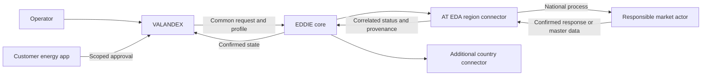

## Purpose and status

This extension of the [Collective Energy Sharing Reference Model](./T4-3_01-collective-energy-sharing.md) describes the complete journey from an operator signing in to the management of confirmed energy-sharing arrangements. VALANDEX is the reference platform; EDDIE provides the common integration boundary and delegates national market procedures to region connectors. Austria is the first country profile. Further countries must be addable without embedding their market rules in VALANDEX or changing the meaning of the common contract.

The target includes peer-to-peer sharing requests, participation and allocation factors, all parameters required by the selected EDA process and schema version, operator onboarding, community master-data queries, repeat synchronisation, customer invitations and join/leave operations. P2P is a service arrangement in the common model. The national profile determines which legally and operationally supported market structure can realise it; selecting P2P in the platform does not create a new national market process.

**Status: reference-model requirements with a locally tested implementation, 15 November 2026.** The lifecycle, capability contract and operator journey below define the target. The implementation now includes the optional common `RegionConnectorEnergySharingService`, a scoped management API, an Austrian adapter for the five operations listed below, and the VALANDEX operator and customer-invitation workflow. Existing Austrian CESU data-access functions remain a separate integration path. The changes are prepared in isolated source branches. No DEV rollout or DSO certification has been performed; local tests do not establish a deployment, external partner registration or complete EDA conformance.

| Implemented locally | Evidence and remaining boundary |
|---|---|
| Country-neutral capabilities, request routing and scoped operation/community lookup | API/core tests cover routing, scope and real-container isolation of the management endpoints from the public port. Country profiles provide parameter schemas and country-qualified metering-point identities. |
| Austrian `JOIN`, `LEAVE`, `CHANGE_PARTICIPATION_FACTOR`, `CHANGE_ALLOCATION` and `SYNC_MASTER_DATA` | The adapter validates generated and correlated inbound messages against pinned EDA schemas, persists request identity and uncertain outcomes, and separates customer consent from market completion. Local tests cover schema mapping, persistence, replay, ordering, revocation and daily change limits. Live market-partner conformance remains to be demonstrated. |
| VALANDEX operator configuration, request history, capability-driven forms and master-data import | Server-managed assignments bind the application connection to its authorised operator. Confirmed responses are polled; background polling does not submit new market commands. Recovery after a confirmed missing request reuses the persisted request ID and body through an explicit retry. |
| Scoped customer invitations and QR/link review | The Energy App integration verifies the customer's owned site and exact invited metering point before explicit consent. VALANDEX stores the immutable invitation request and uses the resulting scoped grant for data access. Local integration tests exercise the invitation and sharing paths; application publication and end-to-end testing on the intended deployment remain separate steps. |

Automatic external XP partner creation, unverified RC/CC-to-community discovery and national operations beyond the advertised profile are not implemented by this extension. The operator setup guidance identifies the required administration steps. The richer semantic objects below describe reference-model requirements, including capabilities that a later country profile may expose; they are not a claim that every field or operation is available in the first Austrian implementation.

## Responsibilities and authoritative records

| Component or actor | Responsibility | Authoritative evidence |
|---|---|---|
| Operator | Selects the community, acts within its verified mandate, invites customers, proposes sharing settings and reviews submissions. | Verified organisation membership and mandate; national market-party/community identity where applicable. |
| Customer and customer energy app | Selects the customer account, site and eligible metering points; reviews the recipient, purpose, duration and actions; grants or withdraws the required approval. | Versioned consent receipt and the outcome of any additional market authorisation. |
| VALANDEX | Operator interface, application/service configuration, invitations, scoped request history and presentation of confirmed arrangements. Keeps proposed settings separate from effective market settings. | Application records and consent references; confirmed regional events are retained with provenance. |
| EDDIE core | Country-neutral request routing, capability discovery, lifecycle/correlation and delivery of results. | Persistent request identifiers, immutable submitted revisions and recorded connector outcomes. |
| Region connector | National validation, partner/setup checks, schema mapping, message exchange, acknowledgements and national process/error interpretation. | Identified native messages and process responses, with schema and profile version. |
| Market authority or responsible market actor | Determines the authoritative community, membership, effective allocation settings and market-process outcome under the national rules. | Confirmed market response or complete authoritative master-data snapshot. |

Application data access, membership of an energy-sharing arrangement and authority to submit market changes are distinct permissions. An energy-app data grant must not silently become a mandate to change participation or allocation. The platform may help collect several approvals in one guided journey, but their purposes, recipients and effects remain explicit.

## Operator onboarding and community synchronisation

### Operator login and community selection

1. The operator signs into VALANDEX and selects the application and operating organisation. Access checks resolve the operator's organisational role before any community or customer information is disclosed.
2. The operator selects the country and market profile. For Austria, the onboarding flow accepts the relevant RC/CC market-party identification and verifies the entitlement to act for the selected community. Knowledge of an identifier alone is insufficient authorisation.
3. EDDIE asks the selected connector for its capabilities and setup state. The response distinguishes an unsupported process, missing configuration, missing partner registration, missing authorisation and a temporary communication failure.
4. The platform resolves community identifiers from a server-authorised RC/CC-to-ECID mapping. If no verified mapping exists, the operator enters the ECID once; that input still requires entitlement verification. When the connector is ready, it queries the known, authorised community and presents the returned metering-point structure for review. The platform creates the scoped local community record and records its national identifiers and provenance. It does not invent community IDs or infer membership from an unrelated data connection.

The initial common operation is `SYNC_MASTER_DATA`. For an Austrian RC/CC operator, the supported query is `EC_PODLIST` for a known ECID. It provides the operator's assigned metering points and their returned attributes; it is not a discovery API for all communities belonging to a market-party number. No published `EC_LIST` process has been established in the reviewed catalogue. `EDA_REQ_EC` is a different master-data process with VNB/EDA roles and must not be represented as an RC/CC discovery route. Automatic onboarding therefore means importing verified mappings and synchronising known communities; it does not promise identifier-only discovery that the market interface does not provide.

An authoritative list response is used to import supported community and metering-point attributes; fields absent from that response remain unknown until obtained from a defined source. A community name or other registration attribute must not be manufactured from the ECID or assumed present in a metering-point list.

### Missing EDA/XP partner setup

If the required partner or transport setup is missing, the operator sees a guided prerequisite task rather than a failed sharing request. It identifies the organisation/market party concerned, the missing prerequisite and the next action, such as completing the EDA partner-registration process, configuring the required XP partner relationship or arranging the appropriate operator mandate.

The connector owns the technical readiness check. Secrets, certificates and transport credentials are configured through the approved administration path, never embedded in an invitation, QR code or customer-facing form. The workflow records `SETUP_REQUIRED` and can recheck readiness after registration. It must not claim to have created an external partner merely because local settings were saved. External partner creation is automated only where an authorised, verified interface exists; otherwise the UI links to and tracks the external registration step. In the current implementation the production PONTON transport must report available, the connection/operator binding must be authorised, and partner readiness must have been verified through administration. The development web/REST Messenger replacement advertises no energy-sharing send capability and cannot be used to submit these requests.

### Initial and repeat synchronisation

The operator can refresh a community on demand and configure repeated queries where the national process permits them. The connector enforces the applicable query limits and retry policy. Every query has a stable request ID, community scope, requested coverage and its own lifecycle; another query cannot overwrite its outcome merely because it finishes first.

For each result EDDIE retains the market source, source message and conversation identifiers, schema/profile version, effective period, receipt time and any source revision or process-ordering information. The common synchronisation model distinguishes a complete snapshot from a partial response or a delta.

Reconciliation follows these rules:

- Deduplicate exact repeated messages by source identity and content; preserve a correction as a new version rather than discarding it because its period was seen before.
- Use the national profile's defined revision and effective-time ordering. Arrival time alone does not prove that a result is newer. An older or unorderable response cannot silently replace a more authoritative current state; it triggers a recorded reconciliation decision or a fresh query.
- Apply each complete, validated snapshot atomically within its country, market-party and community scope. Never combine half of one query with half of another.
- Treat omission as removal only when the source explicitly declares a complete authoritative snapshot for the same coverage and the profile defines that meaning. A partial/failed query must not remove members or links.
- Preserve pending local requests while refreshing confirmed state. Reconcile them using correlated market outcomes; do not infer acceptance solely from a changed list if the process requires a distinct confirmation.
- Retain a readable change history: added or removed members, changed factors, future effective dates, source corrections and unresolved conflicts. Display the last successful synchronisation and freshness separately from the most recent attempt.

For the Austrian implementation, a completed `EC_PODLIST` response is authoritative for its requested date window. A query covering the current date updates that window and preserves previously confirmed periods outside it, including periods for meters omitted from the new response. The connector publishes the assembled canonical snapshot; an empty completed response removes only membership periods covered by the query. Historical-only or future-only query results remain available with their operation and do not replace the current canonical roster. An absent or failed response never means an empty community. Duplicate or older responses cannot overwrite a newer accepted query, and unsolicited customer revocations are scoped to the matching meter and consent and remain deduplicated after later synchronisation.

Application/customer links are separate from market membership. If an authoritative snapshot reveals a membership change, retain the relevant audit record and reevaluate access according to the consent and retention rules; do not silently reassign a meter to a different customer or application.

## Customer invitation and metering-point linking

An operator can invite a customer using a scoped link or QR code from the selected application and community. The token is short-lived, single-purpose and revocable. It carries an opaque reference to the invitation rather than a list of metering points, credentials or a reusable authorisation. Scanning the code starts a review flow and is not itself consent.

The customer signs into the energy app and sees the operator, application, community, requested actions, purpose, requested data and validity period. The customer chooses the site and eligible metering points from the customer's own authorised inventory. For a selected meter, the app confirms the flow direction and any relevant participation/allocation settings before asking for approval. A meter known to the operator is not automatically owned or controlled by the customer.

The persisted link binds the application, provider/operator, community, customer, site, metering point and consent revision. Where the platform supports several applications or tenants, every read and command checks the full scope. The connector separately checks the national identifiers and the authority required for the market operation. A copied invitation, a cross-community request ID or a meter belonging to another customer must not grant access.

After customer approval the platform either reuses an existing valid, appropriately scoped market authorisation or starts the required regional authorisation process. Status is shown explicitly: invitation pending, customer approval received, market authorisation pending, market request submitted, active, rejected or terminated. Data granted to the service is held in its service data domain according to the approved purpose.

The customer can withdraw an invitation approval or data grant and request departure from sharing. Withdrawal of application data access is enforced promptly for future access; the market departure follows its own regional lifecycle and effective date. Conversely, departure from one community does not revoke unrelated application grants.

## Common region-connector contract

The extension is an additive, optional region-connector service. Existing data-access connectors retain their existing interface. A connector that does not implement energy-sharing management advertises no such capabilities and cannot receive an unsupported operation. The types below describe the semantic contract; language-level names, field encodings and endpoints are versioned implementation details.

| Object | Required semantic content |
|---|---|
| `EnergySharingRequest` | Request ID and idempotency key; country and connector/profile/version; operation; application/operator/community scope; actor/authority and consent references where required; arrangement type; affected metering points and direction; requested effective period; distinct participation and allocation settings; expected revision; typed national parameters. |
| `EnergySharingProfile` | Country and national scheme; supported process/schema versions; required identifiers; field definitions, units, precision and conditional requirements; operation-specific validation; mapping rules; effective-date/calendar/time-zone rules; ordering and reconciliation rules; authorisation and partner prerequisites. |
| `EnergySharingCapabilities` | Supported operations and arrangement types; setup and authorisation prerequisites; active profile/schema versions; supported factor/mechanism changes; query/refresh support; validation and restrictions; reason when an operation is unavailable. Capabilities are evaluated for the selected operator/community, not only the connector globally. |
| Request status/result | Common lifecycle status; submitted revision and effective date; native process/message/correlation identifiers; native outcome/error and common interpretation; retryability; resulting authoritative revision; links to consent and provenance. |
| Reference-data result | Query and community scope; complete snapshot/delta/partial marker; effective coverage; source ordering/version information; identities and mapped community/member attributes; retained national fields; receipt timestamp and reconciliation outcome. |

The common operation vocabulary covers reference-data synchronisation, join, leave, participation-factor changes, allocation-share changes and allocation-mechanism changes. Draft validation is separate from submission. Cancellation of an unexecuted request and termination of an active arrangement are different operations; a profile exposes each only when the national process supports it. The initial Java service exposes `capabilities`, `submit`, scoped `operation` lookup and scoped `communities` lookup. The request ID is the durable idempotency key, and profile metadata and parameter schemas are carried in the capability response; a separate persisted `EnergySharingProfile` class is not required by this semantic model.

National fields use a versioned, typed profile with an explicit schema and validation. They are not an unvalidated free-form object and must not be silently ignored by a connector. The common core preserves their semantics and routes them intact; the national connector maps them to the selected transport schema. A country may add identifiers, required evidence or other parameters without changing existing countries' meanings.

Adding a country requires a connector implementation, a versioned profile and conformance fixtures covering supported operations, errors and confirmations. VALANDEX obtains the relevant form fields and actions from the supported profile/capability metadata rather than relying on Austria-specific conditions in the common workflow. National legal availability and operating arrangements remain explicit prerequisites.

## Request management and confirmation

The operator can prepare, validate, submit and inspect a sharing request and its history. An accepted HTTP response or transport acknowledgement only confirms the stage it represents. The application shows an arrangement or factor as effective only after the required authoritative confirmation and effective date.

| Stage | Meaning and allowed behaviour |
|---|---|
| Draft | Editable proposal; no market side effect. Optimisation may recommend factors in this stage. |
| Validation required / invalid | Country, scope, consent, fields, totals and effective dates are checked. Field errors explain how to correct the request. |
| Setup or authorisation required | Submission is held pending the specific external prerequisite. A customer grant and operator mandate are checked separately. |
| Ready | The exact revision is valid for the selected capability/profile. Recheck material prerequisites when submitting. |
| Submitted / awaiting response | The persisted revision and outbound correlation remain immutable. Repeated submission with the same idempotency key returns the existing request rather than sending a duplicate. |
| Confirmed / scheduled | Market acceptance is recorded. A future change remains scheduled until its effective time. |
| Effective | The confirmed change is active for its effective period and reflected in the operator view. |
| Rejected / failed | Preserve the native reason, affected fields and retryability. A corrected request creates a new revision or new process according to the profile. |
| Cancellation or termination pending | Show the outstanding request and the still-effective arrangement separately. Do not report completion before confirmation. |
| Cancelled / terminated | Record the authoritative outcome and effective end; retain the permitted history. |

An optimistic concurrency check prevents a request prepared against an old community version from overwriting a more recent confirmed change. A timeout without a definitive market result is an uncertain outcome, not permission to submit a new duplicate request. Retries use the profile's recovery rules and the original correlation.

Join and leave operations implement Procedures 4, 6 and 7. Factor and mechanism changes elaborate Procedure 14. Confirmed allocation and self-consumption data feed Procedures 11a/11b. Pricing, financial settlement and the optimisation objective are separate from the authority to alter regulated market allocations; a recommended allocation is never automatically represented as market-approved.

## Austrian EDA profile

The Austrian profile must be tied to the exact process and schema versions used by the connector. RC/CC operator onboarding, EC reference-data queries and the relevant participation/change processes are mapped individually. A process listed in EDA documentation is not necessarily implemented or enabled in the deployed connector.

### Confirmed process distinctions

The reviewed process catalogue establishes the following implementation requirements. The profile must pin these versions and preserve any more restrictive process conditions; a later catalogue release requires a new review.

| Operation | Process/version and messages | Required distinction |
|---|---|---|
| Query an authorised community's assigned metering points | [EC_PODLIST 02.10](https://www.ebutilities.at/prozesse/736); `CPRequest` 01.12 request, `SENDEN_ECP` with `ECMPList` 01.20 response. | The request uses ECID in `MeteringPoint` and the defined date-range extension. It returns only the requester's assignments and may be empty. An empty completed response and absence of a response are different outcomes. It does not discover arbitrary ECIDs. |
| Online join | [EC_REQ_ONL 03.00](https://www.ebutilities.at/prozesse/711); schema set `EC_REQ_ONL_02.40`, `CMRequest` 01.30, `CMNotification` 01.20 and completion through `ECMPList` 01.20. | Required fields include `DateFrom`, `MeteringPoint`, `ECID`, `EnergyDirection`, `ReqDatType=EnergyCommunityRegistration` and integer `ECPartFact` 1–100. `DateTo` is not permitted in this online request. Customer consent is not the final completion message. |
| Change participation factor | [EC_PRTFACT_CHANGE 01.10](https://www.ebutilities.at/prozesse/718); `ANFORDERUNG_CPF` with `ECMPList` 01.20 and `CPNotification` 01.13 response/rejection. | Changes `ECPartFact`, separately from allocation share. Apply the process's per-meter/community change limit and effective-date rules. |
| Change static allocation share | [EC_PRT_CHANGE 02.10](https://www.ebutilities.at/prozesse/722); `ANFORDERUNG_ECC` and `ECMPList` response; rejection through `CPNotification` 01.13. | Changes `ECShare` for static allocation, from 0 to 100 with at most four decimal places. It is not a participation-factor update or a generic mechanism-change endpoint. |
| Leave by operator | [CM_REV_SP 01.40](https://www.ebutilities.at/prozesse/727); `AUFHEBUNG_CCMS` with `CMRevoke` 01.10 and `CMNotification` 01.20 response/rejection. | Carry the known consent and meter IDs and requested `ConsentEnd`; submission is not confirmed termination. Customer and implicit revocations use their own incoming lifecycle messages. |
| Retrieve other EC master data | [EDA_REQ_EC 01.10](https://www.ebutilities.at/prozesse/732). | The reviewed roles are VNB/EDA; this process must not be offered as RC/CC community discovery. |

For online join, the requested start is subject to the specified window from the following day to 30 working days. Factor-change processes impose one change per day, metering point and community, with receipt between 09:00 and 17:00 associated with the following-day rule. Implement the complete national business-calendar and process rules, including treatment outside this window, from the pinned official specification; the summary here is not a substitute for those rules. The UI must not present an arbitrary immediate effective date.

Leave and mechanism-change operations remain separate capability entries. Their authority, mapper and confirmation handling must be verified before activation; the existence of the online-join or factor-change process does not imply their support. Incoming [customer revocation](https://www.ebutilities.at/prozesse/726) and [implicit revocation](https://www.ebutilities.at/prozesse/728) must update the authoritative state without requiring an open browser session.

For new DSO contracts from 5 October 2026, the reviewed rules require dynamic distribution; existing static contracts can continue. The profile therefore must not offer static allocation for a newly contracted P2P arrangement simply because `ECShare` exists in the schema. The private P2P trading agreement is separate from DSO participation and EDA message exchange. [Official registration guidance](https://energiegemeinschaften.gv.at/registrierung-als-marktpartner/), [P2P agreements](https://energiegemeinschaften.gv.at/peer-to-peer-vertraege/).

### Distinct factor semantics

| Concept | Common meaning | Austrian mapping and implementation requirement |
|---|---|---|
| Participation factor | Extent to which a metering point participates in a particular sharing arrangement. | `ECPartFact`. Existing CESU onboarding uses a whole-number participation factor from 1 to 100. Other national operations must use the constraints of their specific EDA version; do not infer them from an unrelated endpoint. |
| Allocation share | Share assigned to a member by the applicable allocation scheme. | `ECShare` where the selected process/schema permits it. Preserve its defined unit and precision; do not convert it to `ECPartFact` or apply the integer join-factor validator. |
| Calculated allocation | Result of the applied sharing/calculation process. | Fields such as `ECShareCalc` where present in the confirmed result. A calculated result is not an instruction to change a factor. |
| Allocation mechanism | Static/dynamic or other nationally supported rule determining allocation. | Map to the relevant process and enumerated values. Changing the mechanism is a distinct capability from changing an individual share. |

Participation totals and allocation totals have different meanings. Apply only the profile's applicable constraints, direction rules and effective-period rules. Do not impose a universal sum-to-100 rule on unrelated fields or directions; do not accept inconsistent totals where the selected process requires a complete allocation set.

### Parameter coverage and provenance

Before enabling a national operation, maintain a process/version coverage matrix. Each schema field must be classified as caller-supplied, derived from verified configuration, generated transport metadata, returned by the market, conditionally required, or explicitly unsupported. An operation is not complete when a required or applicable field is silently dropped.

| Parameter group | Required treatment |
|---|---|
| Operator, community and market participants | Preserve the selected RC/CC identity, community identity, receiver/responsible party and their identifier schemes; verify the mandate and configured partner relationship. |
| Process and transport metadata | Map message/process codes, schema version, message and conversation IDs, request IDs, sender/receiver, production/test mode, creation time and duplicate/retry semantics to the verified EDA schema. User inputs cannot override generated identity or routing fields. |
| Metering-point and participant attributes | Preserve identifiers, energy direction, eligible role and relevant membership dates. Validate using the appropriate process version and authority. |
| Requested periods and delivery | Map effective/start/end dates, intervals, transmission cycle and purpose where those belong to the selected process. Do not assume every process has the same date or delivery fields. |
| Sharing configuration | Map participation factor, allocation share, mechanism and their period-specific constraints separately. Preserve decimal precision where required. |
| Master-data and result fields | Map community/metering-point lists, effective periods, current factors, calculated values, confirmations and errors; retain source identifiers and corrections. Returned-only fields cannot become writable settings. |

The matrix must cite the official schema/process source and distinguish verified support from pending mappings. Conformance fixtures must include conditional and boundary cases. When a new schema version introduces an unmapped required field, the affected operation is unavailable until the profile and mapper are updated; unaffected existing versions remain usable where allowed.

The initial Austrian coverage review must explicitly account for these structures:

| Schema | Fields that must survive mapping or have an explicit process-specific disposition |
|---|---|
| [CMRequest 01.30](https://www.ebutilities.at/schemata/customerconsent/cmrequest/01p30/CMRequest_01p30.xsd) | Routing/transport envelope; `MessageId`, `ConversationId`, `ProcessDate`, `MeteringPoint`, `CMRequestId`, `ConsentId` when applicable and `AdditionalData`; request type, interval, transmission cycle, start, community, factors, direction and purpose. The online process prohibits `DateTo` even though the general schema permits it. |
| [ECMPList 01.20](https://www.ebutilities.at/schemata/customerprocesses/ecmplist/01p20/ECMPList_01p20.xsd) | Process IDs/date; `ECID`, `ECType`, `ECDisModel`, `ECZoneLevel`; each meter/consent ID; every `MPTimeData` segment including `DateFrom`, `DateTo`, `DataType`, `DateActivate`, direction, participation, transmission, purpose, technology/fuel codes, deactivation and allocation share; each `ECShC` period and calculated share. |
| [CPRequest 01.12](https://www.ebutilities.at/schemata/customerprocesses/cprequest/01p12/CPRequest_01p12.xsd) for EC_PODLIST | Message/conversation IDs, process date and ECID in `MeteringPoint`; requested `DateTimeFrom`/`DateTimeTo`; the structurally required `AssumptionOfCosts` field of the extension. Do not expose unrelated CPRequest fields as EC_PODLIST options. |
| [CMRevoke 01.10](https://www.ebutilities.at/schemata/customerconsent/cmrevoke/01p10/CMRevoke_01p10.xsd) | Message/conversation IDs, consent and meter IDs, `ConsentEnd`, optional `ReasonKey` and `Reason` under the process rules. |

Do not flatten historical and future `MPTimeData` segments into a single current factor. Required `DateTo`, `DateActivate` and `DataType` values in factor-change messages must come from authoritative data or validated process input, not fabricated defaults. In returned membership data, `DateTo` and `DateDeactivate` identify the inclusive last energy-distribution day. A completed empty ECMPList is valid; a missing or incomplete reply remains pending and cannot empty the local membership list. `PlantCategory` is not a field in ECMPList 01.20.

Map common application IDs to the actual [CPCommonTypes 01.20](https://www.ebutilities.at/schemata/customerprocesses/common/types/01p20/CPCommonTypes_01p20.xsd) constraints. For example, message/conversation/consent grouping IDs are alphanumeric and at most 35 characters; a UUID with hyphens cannot be copied into such a field unchanged. Retain the mapping for correlation and replay protection.

## Acceptance and verification

The extension is ready for a specific country/operation only when the following have evidence:

1. An authorised operator can sign in, select the correct market-party/community scope and import a complete authoritative reference-data result. An unauthorised operator cannot query or change another community by supplying its ID.
2. Missing partner/XP configuration produces a guided setup task; a readiness recheck resumes onboarding without duplicating partners or requests.
3. Repeated queries, duplicates, late responses, partial responses and source corrections preserve ordering and confirmed state. Failed or partial refreshes do not delete memberships. Query provenance and freshness are visible.
4. QR invitations require authentication and explicit customer approval; customer/site/meter scopes, expiry, revocation and cross-application isolation are enforced.
5. Join, leave and each supported factor/mechanism change have independent capability checks, correct national fields, idempotency, concurrency protection and confirmed effective dates. Unsupported operations are visibly unavailable.
6. Participation and allocation factors retain distinct meaning, precision and validation through the complete request-to-transport-to-confirmation round trip.
7. The process/version coverage matrix accounts for every applicable EDA field and is supported by schema validation and representative positive, rejection and recovery fixtures. A named test/partner environment exchange is required before claiming market interoperability.
8. A second test profile can be added without Austrian identifiers or constraints leaking into the core contract. Existing data-access and CESU integrations continue to work.

Local contract and mapper tests, official-schema validation, partner-environment exchange, production activation and deployed UI verification are separate evidence categories. Passing one does not imply the others. Record the checked source revision, profile/schema version, environment, date and remaining gaps for each enabled operation.

## Sources and implementation evidence

The parent reference model supplies the harmonised roles, procedures and distinction between participation and allocation factors. The tables above link the official process and schema sources for the Austrian mapping. The [official BEM rollout plan](https://www.ebutilities.at/documents/2026/05/Stufenplan_B%C3%BCrgerenergemodelle_2026_V2.pdf) describes later phases; later cross-DSO or multiple-daily-change capabilities must not be advertised as current merely because they appear in the roadmap. National source versions and the operator's enabled market setup remain decisive.

The inspected EDDIE baseline contains `CesuManagementController`, `CESUJoinRequestDataNeed`, `CMRequest01p30` and ECMPList handlers. At that baseline the join message maps participation factor and community identity, while the presence of allocation fields in incoming schema fixtures does not prove writable allocation-change support. The initial optional management SPI is under `energy.eddie.api.agnostic.energysharing`. Its versioned parameter schemas and national adapters must be checked against the requirement and coverage tables above. Completion of the full operator journey, market interoperability and deployed availability requires the separate evidence described in the acceptance section.
